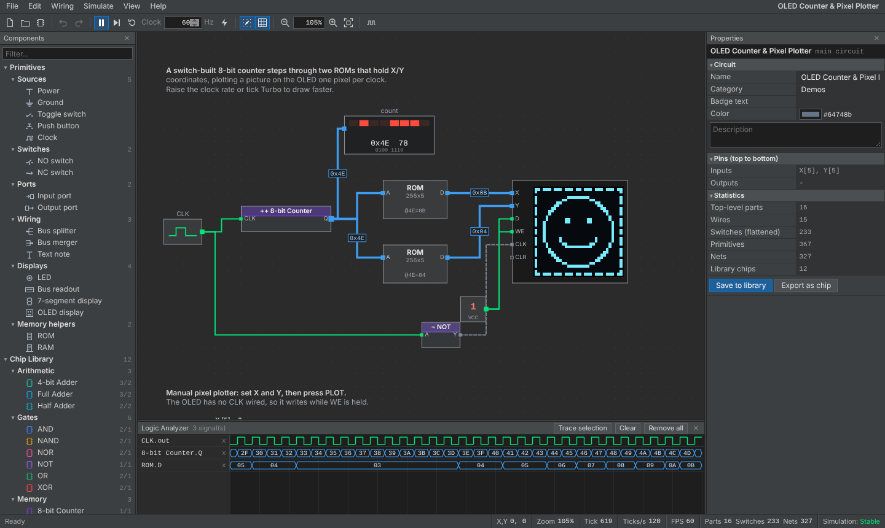

# Switchboard

**A switch-level digital logic simulator that runs in your browser.**

No gates are built in. You start with power, ground and voltage-controlled switches, and build everything else yourself: NOT, AND, OR and XOR, then adders, latches, flip-flops, counters, ALUs and CPUs. Save each design as a reusable chip and nest it inside the next one.

The whole app is one HTML file. It has no dependencies, needs no build step and works offline.



---

## Getting started

1. Download `switchboard.html`.
2. Open it in any modern browser (Chrome, Edge, Firefox or Safari).

That's all. Your circuit and chip library save automatically in your browser's local storage.

### Hosting it on GitHub Pages

Rename `switchboard.html` to `index.html`, push it to a repository, then turn on **Settings → Pages** for that branch.

---

## How it works

### Primitives

| Part | Behavior |
|---|---|
| **Power / Ground** | Constant `1` / constant `0` |
| **Toggle switch** | Click to flip between `0` and `1` |
| **Push button** | Outputs `1` only while held down |
| **Clock** | Toggles every tick. One global rate, with run, pause, step and turbo |
| **NO switch** | Normally open: passes `in → out` while `ctrl = 1`. When open, the output floats |
| **NC switch** | Normally closed: passes `in → out` while `ctrl = 0`. When open, the output floats |
| **Input / Output ports** | Named pins (1–32 bits) that become the pins of a saved chip |

For example, a NOT gate is a single NC switch fed from Power. An AND gate is two NO switches in series, and an OR gate is two in parallel.

### Signal rules

- Every wire bit is in one of four states: driven **1**, driven **0**, **floating (Z)** or **shorted (X)**.
- A floating wire reads as `0` (pull-down) and is drawn as a dashed grey line.
- Several outputs may drive the same wire. If one drives a `1` while another drives a `0`, that's a short: the wire turns red and the status bar counts it. The simulation keeps running.
- Signals change with zero delay. The simulator only re-evaluates parts whose inputs changed, and caps the work per clock tick. A loop that never settles, like a ring of three inverters, shows **Oscillating** instead of freezing the app.

### Chips and nesting

1. Build a circuit that has Input and Output ports.
2. Give it a name, category, badge and color in the **Properties** panel.
3. Press **Ctrl+S** (or *Edit → Save circuit to library*).

The chip appears in the **Chip Library** tree, and you can place as many copies as you like. Double-click a copy to open and edit what's inside; **Save chip** updates every copy. Pins appear on the chip in the top-to-bottom order of the ports. A chip can't contain itself, directly or through another chip.

Each chip is compiled once into a cached flat circuit and reused for every copy. Deep nesting, such as switches → gates → adder → ALU → CPU, doesn't slow down the editor.

### Displays and helper parts

| Part | Pins / behavior |
|---|---|
| **LED** | 1-bit light, with a choice of color |
| **Bus readout** | LED bar plus binary, decimal and hex values for 1–32 bits |
| **7-segment display** | 4-bit hex mode, or raw `a`–`g` + `dp` segments |
| **OLED display** | 16×16, 32×32 or 64×64 pixels; mono (1-bit), grayscale (4-bit) or RGB 3-3-2 (8-bit). Pins `X`, `Y`, `D`, `WE`, `CLK`, `CLR`. With `CLK` wired it writes on each rising clock edge; without it, it writes whenever `WE = 1` |
| **ROM** | Up to 16 address bits and 32 data bits. Contents are typed as hex by default; `0b` for binary, `#` for decimal, `@addr` to jump, `;` for comments |
| **RAM** | Writes on a rising `CLK` edge when `WE = 1`; reading is always live |
| **Bus splitter / merger** | Converts between a bus and its individual bits (`b0` is the lowest bit) |

ROM, RAM and the hex display mode are shortcuts for testing. Building their equivalents yourself, from flip-flops and decoders, is part of the challenge.

### Logic analyzer

Select a wire or part and press **T**. Its signal appears in the waveform strip at the bottom, with one column per clock tick or input change. Multi-bit signals show their hex value.

---

## Examples

Under **File → Examples**. Loading one adds its ready-made chips to your library, so skip them if you want to build everything yourself first.

1. **Switch-level NOT / XOR demo**: switch-only gates, a CMOS-style inverter and a press-to-short button.
2. **4-bit adder with displays**: a ripple-carry adder built from full adders, half adders, gates and switches.
3. **OLED counter & pixel plotter**: a switch-built 8-bit counter reads X/Y points from two ROMs and draws a picture on the OLED. There's also a manual pixel plotter.

---

## Keyboard shortcuts

| Keys | Action |
|---|---|
| Drag from pin to pin | Draw a wire |
| Click empty canvas while wiring | Add a bend point |
| Double-click chip | Open its circuit |
| `Ctrl+Z` / `Ctrl+Y` | Undo / redo |
| `Ctrl+X` / `C` / `V` / `D` | Cut / copy / paste / duplicate |
| `Ctrl+A` | Select all |
| `Del`, `Backspace` | Delete |
| `R` / `Shift+R` | Rotate clockwise / counter-clockwise |
| `F` | Flip |
| `T` | Trace in logic analyzer |
| `P` | Run / pause clock |
| `.` | Step one clock edge |
| `G` | Toggle grid snap |
| `Ctrl+S` | Save chip / save circuit to library |
| `Ctrl+O` | Import JSON |
| Wheel | Zoom |
| Right-drag, middle-drag, `Space`+drag | Pan |
| Right-click | Context menu |
| `Home`, `0` | Zoom to fit |
| `Esc` | Cancel |

---

## Saving and sharing

Your work auto-saves in your browser's local storage. That storage belongs to one browser on one machine, so export regularly to keep backups or move between computers:

- **File → Export project bundle**: your circuit plus the entire library
- **File → Export library**: just the chips
- **Export** on a library chip: that chip plus every chip it depends on
- **File → Open / import JSON**: reads any of the files above

---

## Limitations

The simulation is idealized:

- Signals change instantly; there is no gate delay.
- Switches conduct in one direction only.
- Floating wires read as `0`.
- There is a single global clock.

It's built for learning how logic works, not for analog or exact timing analysis.

---

## Project structure

```
switchboard.html   the complete app: simulation engine and editor in one file
screenshot.png     preview image for this README
```
